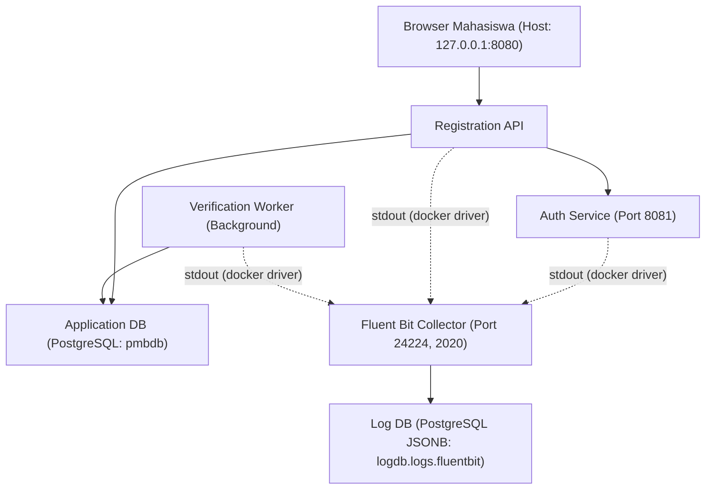

# LAPORAN PRAKTIKUM DEVSECOPS
## BAB 6: CENTRALIZED LOGGING DENGAN FLUENT BIT DAN POSTGRESQL

* **Mata Kuliah:** DevSecOps / Keamanan Perangkat Lunak  
* **Topik:** Centralized Logging, Structured Logging, Distributed Tracing (`request_id`), Log Resilience & Buffering  
* **Aplikasi:** Laboratorium PMB (Penerimaan Mahasiswa Baru)  
* **Tanggal Pelaksanaan:** 28 Oktober 2026  
* **Status Pengujian:** **SELURUH PENGUJIAN LULUS (PASS)**  

---

## 1. TUJUAN PRAKTIKUM

1. Membedakan peran basis data transaksional (`app-db`) dan backend penyimpanan centralized logging (`log-db`).
2. Menerapkan *structured logging* berbasis JSON dari `stdout` tanpa membocorkan kredensial atau informasi data pribadi (*Zero Secret Leak* / *PII Redaction*).
3. Mengkorelasikan jejak transaksi lintas layanan microservice secara *end-to-end* menggunakan `request_id`.
4. Merekonstruksi kronologi insiden kegagalan dependency asinkron menggunakan query SQL pada PostgreSQL JSONB.
5. Menguji mekanisme *retry*, *timeout*, *filesystem buffering*, dan *backlog recovery* pada Fluent Bit saat backend log mengalami *downtime*.
6. Mengumpulkan artefak *evidence* yang valid dan dapat diverifikasi integritasnya tanpa menyertakan berkas rahasia (`.env`).

---

## 2. ARSITEKTUR & TOPOLOGI SISTEM

Sistem laboratorium PMB terdiri dari 6 container yang terisolasi dalam Docker Compose:



### Tabel Komponen Layanan
| Service | Image / Base | Peran & Tanggung Jawab | Eksposur Jaringan |
|---|---|---|---|
| `registration-api` | Python 3 (Gunicorn) | Portal UI, otentikasi sesi, validasi formulir PMB | `127.0.0.1:8080` (Host) |
| `auth-service` | Python 3 (Gunicorn) | Layanan autentikasi internal (verifikasi hash + salt) | Internal `app-net` |
| `verification-worker` | Python 3 | Worker asinkron verifikasi dokumen calon mahasiswa | Internal `app-net` |
| `app-db` | `postgres:16-alpine` | Basis data transaksi pendaftaran (`registrations`) | Internal `app-net` |
| `fluent-bit` | `fluent/fluent-bit:4.2.8` | Log collector, storage buffering, dan routing PostgreSQL | `127.0.0.1:2020`, `24224` |
| `log-db` | `postgres:16-alpine` | Penyimpanan centralized log (`logs.fluentbit` tipe `jsonb`) | Internal `logging-net` |

> 📷 **[TARUH SCREENSHOT 1 DI SINI]**  
> **Keterangan:** Bukti status 6 container aktif dan port mapping host (`127.0.0.1:8080->8080` dan `127.0.0.1:2020->2020`).  
> **Perintah:** `docker compose ps`  
> *(Ganti baris ini dengan gambar: ``)*

---

## 3. HASIL PENGUJIAN DAN EKSEKUSI SKENARIO

### 3.1. Validasi Statis dan Unit Testing
Pengujian unit dijalankan untuk menguji keabsahan penanganan `request_id` dan fungsi redaksi kredensial:
* `test_invalid_request_id_is_replaced`: **PASS** (Request ID non-standar diganti otomatis dengan format valid).
* `test_sensitive_fields_are_redacted`: **PASS** (Field `password`, `cookie`, `token`, `secret` diganti menjadi `[REDACTED]`).
* `test_valid_request_id_is_preserved`: **PASS** (Request ID resmi client diteruskan tanpa modifikasi).

> 📷 **[TARUH SCREENSHOT 2 DI SINI]**  
> **Keterangan:** Bukti validasi statis Compose dan pengujian unit redaction `OK`.  
> **Perintah:** `./scripts/validate.sh`  
> *(Ganti baris ini dengan gambar: ``)*

---

### 3.2. Tahap A: Baseline (Skenario Normal)
* **Kondisi:** Mode insiden diatur ke `none` (`./scripts/set-incident.sh none`).
* **Request ID:** `REQ-010ff90db10c4972bdbbcfc8b52f4813`
* **Status Transaksi:** **`VERIFIED`** (Attempt: `1`)

**Kronologi Event pada Centralized Log:**
1. `auth-service` ➔ `login_success` (User `student` terotentikasi).

  
*Gambar 3a: Tampilan antarmuka login portal PMB (`http://localhost:8080/login`).*

2. `registration-api` ➔ `registration_submitted` (Formulir diterima, status awal `SUBMITTED`).
3. `verification-worker` ➔ `verification_started` (Worker mengklaim pendaftaran via `FOR UPDATE SKIP LOCKED`).
4. `verification-worker` ➔ `verification_completed` (Verifikasi berkas berhasil dalam 1 detik).
5. Database `app-db` ➔ Status akhir diperbarui menjadi `VERIFIED`.

> 📷 **[TARUH SCREENSHOT 3 DI SINI]**  
> **Keterangan:** Tampilan browser saat pendaftaran formulir PMB.  
> **Akses Browser:** Buka `http://localhost:8080/register` (setelah login `student` / `StudentLab!2026`).  
> *(Ganti baris ini dengan gambar: ``)*

> 📷 **[TARUH SCREENSHOT 4 DI SINI]**  
> **Keterangan:** Hasil eksekusi script demo normal di terminal yang menghasilkan status `VERIFIED`.  
> **Perintah:** `./scripts/demo-normal.sh`  
> *(Ganti baris ini dengan gambar: ``)*

---

### 3.3. Tahap B: Failure Injection (Skenario Insiden Timeout)
* **Kondisi:** Mode insiden diatur ke `timeout` (`./scripts/set-incident.sh timeout`).
* **Request ID:** `REQ-e690dacf4c0f46c191b515c972f40070`
* **Status Transaksi:** **`FAILED`** (Attempt: `3`, Failure Code: `VERIFY-TIMEOUT`)

**Kronologi Rekonstruksi Insiden (Berdasarkan Centralized Log):**
1. Transaksi dikirim oleh API: `registration_submitted`.
2. Worker memulai verifikasi: `verification_started`.
3. Worker mendeteksi dependency `document-verifier` tidak merespons:
   - **Retry 1 (WARN):** `verification_retry` (attempt 1)
   - **Retry 2 (WARN):** `verification_retry` (attempt 2)
   - **Retry 3 (WARN):** `verification_retry` (attempt 3)
4. Worker mencapai batas maksimal retry:
   - **ERROR:** `dependency_timeout` (error_code: `VERIFY-TIMEOUT`).
5. Database `app-db` mengunci transaksi pada status `FAILED`.

> 📷 **[TARUH SCREENSHOT 5 DI SINI]**  
> **Keterangan:** Hasil eksekusi script insiden di terminal (Attempt 3 dan status `FAILED / VERIFY-TIMEOUT`).  
> **Perintah:** `./scripts/demo-incident.sh`  
> *(Ganti baris ini dengan gambar: ``)*

> 📷 **[TARUH SCREENSHOT 6 DI SINI]**  
> **Keterangan:** Perbandingan seluruh status transaksi pada tabel database transaksi `app-db`.  
> **Perintah:**  
> `set -a; source .env; set +a`  
> `docker compose exec -T app-db psql -U "$APP_DB_ADMIN_USER" -d "$APP_DB_NAME" -c "SELECT public_id, status, attempt, failure_code, request_id FROM registrations ORDER BY submitted_at;"`  
> *(Ganti baris ini dengan gambar: ``)*

---

### 3.4. Tahap C: Recovery Sistem
* **Kondisi:** Mode insiden dikembalikan ke `none` (`./scripts/set-incident.sh none`).
* **Pengujian Transaksi Baru:** Request ID `REQ-03049fdda09e47c8984272f6c7151616`.
* **Hasil:** Status transaksi baru langsung berstatus **`VERIFIED`**.
* **Observasi Transaksi Lama:** Transaksi yang berstatus `FAILED` pada Tahap B tetap berada pada status `FAILED` dan tidak diproses ulang secara otomatis. Hal ini membuktikan sistem menerapkan mekanisme *fail-fast* yang mencegah siklus retry tak terbatas (*infinite loop retry*).

> 📷 **[TARUH SCREENSHOT 7 DI SINI]**  
> **Keterangan:** Bukti pengembalian mode ke `none` dan transaksi baru kembali sukses `VERIFIED`.  
> **Perintah:** `./scripts/set-incident.sh none && ./scripts/demo-normal.sh`  
> *(Ganti baris ini dengan gambar: ``)*

---

### 3.5. Tahap D: Resilience Logging & Storage Buffering
* **Skenario:** Menguji ketahanan pipeline saat backend penyimpanan log (`log-db`) dimatikan sementara.
* **Langkah:**
  1. Kontainer `log-db` dihentikan (`docker compose stop log-db`).
  2. Transaksi baru (`REQ-7fb2328e043448e1a39b93c4046f90d7`) dijalankan melalui portal PMB.
  3. Transaksi bisnis pada aplikasi tetap sukses berstatus **`VERIFIED`** (tidak terblokir oleh matinya logging).
  4. Fluent Bit mencatat kegagalan flush ke PostgreSQL dan memindahkan chunk log ke buffer lokal disk (`/var/log/flb-storage`).
  5. Kontainer `log-db` diaktifkan kembali (`docker compose start log-db`).
  6. Fluent Bit mendeteksi database log telah pulih dan melakukan *flush backlog* otomatis.
  7. Seluruh record log berhasil disimpan tanpa kehilangan data transaksi.

> 📷 **[TARUH SCREENSHOT 8 DI SINI]**  
> **Keterangan:** Log Fluent Bit yang membuktikan terjadinya retry dan penyimpanan chunk ke buffer saat log-db mati.  
> **Perintah:** `docker compose logs --tail 25 fluent-bit`  
> *(Ganti baris ini dengan gambar: ``)*

---

## 4. ANALISIS QUERY SQL PADA DATABASE CENTRALIZED LOG

Hasil eksekusi `queries/incident-analysis.sql` pada tabel `logs.fluentbit`:

### 4.1. Distribusi Event Log Berdasarkan Service
```text
                tag                | total_event 
-----------------------------------+-------------
 pmb.pmb-lab-registration-api-1    |          69
 pmb.pmb-lab-auth-service-1        |          27
 pmb.pmb-lab-verification-worker-1 |          10
```

> 📷 **[TARUH SCREENSHOT 9 DI SINI]**  
> **Keterangan:** Hasil query SQL distribusi event per service pada tabel `logs.fluentbit`.  
> **Perintah:**  
> `docker compose exec -T log-db psql -U "$LOG_DB_ADMIN_USER" -d "$LOG_DB_NAME" -c "SELECT tag, count(*) AS total_event FROM logs.fluentbit GROUP BY tag ORDER BY total_event DESC;"`  
> *(Ganti baris ini dengan gambar: ``)*

---

### 4.2. Kronologi Investigasi Request ID Insiden
Rekonstruksi alur transaksi pada request ID `REQ-e690dacf4c0f46c191b515c972f40070`:

```text
       service       |       event_name       | severity | attempt |   error_code   
---------------------+------------------------+----------+---------+----------------
 registration-api    | http_request           | INFO     |         | 
 registration-api    | registration_submitted | INFO     |         | 
 verification-worker | verification_started   | INFO     |         | 
 verification-worker | verification_retry     | WARN     |       1 | 
 verification-worker | verification_retry     | WARN     |       2 | 
 verification-worker | verification_retry     | WARN     |       3 | 
 verification-worker | dependency_timeout     | ERROR    |       3 | VERIFY-TIMEOUT
```

> 📷 **[TARUH SCREENSHOT 10 DI SINI]**  
> **Keterangan:** Rekonstruksi kronologi event insiden menggunakan query SQL filtering `request_id`.  
> **Perintah:**  
> `docker compose exec -T log-db psql -U "$LOG_DB_ADMIN_USER" -d "$LOG_DB_NAME" < queries/incident-analysis.sql`  
> *(Ganti baris ini dengan gambar: ``)*

---

### 4.3. Audit Kerahasiaan (Zero Secret Leak)
Query audit pola sensitif:
```sql
SELECT count(*) FROM logs.fluentbit 
WHERE data ->> 'log' ~* '(password|authorization|bearer|cookie|session[_-]?secret|api[_-]?key)';
```
**Hasil Temuan: `0 record` (PASS)**  
Tidak ada string kata sandi, token otorisasi, maupun session cookie yang bocor ke dalam data log terpusat.

> 📷 **[TARUH SCREENSHOT 11 DI SINI]**  
> **Keterangan:** Bukti query audit kerahasiaan menghasilkan count `0` (Zero Temuan Secret).  
> **Perintah:**  
> `docker compose exec -T log-db psql -U "$LOG_DB_ADMIN_USER" -d "$LOG_DB_NAME" -c "SELECT count(*) AS total_temuan_secret FROM logs.fluentbit WHERE data ->> 'log' ~* '(password|authorization|bearer|cookie|session[_-]?secret|api[_-]?key)';"`  
> *(Ganti baris ini dengan gambar: ``)*

---

## 5. JAWABAN PERTANYAAN ANALITIS

### 1. Mengapa status container `Up` tidak membuktikan fungsi bisnis sehat?
Status container `Up` hanya mengindikasikan bahwa proses sistem operasi (PID 1) di dalam container masih berjalan dan belum menerima sinyal terminasi (*exit code*). Docker daemon tidak memiliki visibilitas ke dalam logika aplikasi bisnis internal. Sebagai contoh pada Tahap B, container `verification-worker` tetap berstatus `Up (healthy)`, padahal transaksi pendaftaran terhenti akibat kegagalan koneksi (*timeout*) ke dependensi verifikasi dokumen. Oleh sebab itu, observabilitas sejati memerlukan pemantauan metrik aplikasi dan log terdistribusi, bukan sekadar status kontainer.

### 2. Apa perbedaan event time, waktu penerimaan collector, dan waktu penyimpanan database?
* **Event Time:** Waktu saat sebuah peristiwa terjadi di level aplikasi (dibuat menggunakan fungsi `utc_now()` pada kode sumber).
* **Collector Time (Waktu Penerimaan Collector):** Waktu saat payload log diterima dari driver logging Docker oleh daemon Fluent Bit di port 24224.
* **Database Time (Waktu Penyimpanan Database):** Waktu saat baris data log berhasil di-`INSERT` ke tabel `logs.fluentbit` di PostgreSQL (`CURRENT_TIMESTAMP`).
* **Signifikansi:** Perbedaan waktu ini mencerminkan latensi jaringan, antrean pemrosesan, serta durasi buffering lokal saat backend penyimpanan sedang lambat atau mengalami gangguan.

### 3. Mengapa nama dan email tidak dimasukkan ke structured log?
Peniadaan nama dan email pada log terstruktur bertujuan untuk mematuhi prinsip **Data Minimization (Minimalisasi Data)** sebagaimana diatur dalam regulasi privasi global (GDPR) dan UU Pelindungan Data Pribadi (UU PDP). Centralized log umumnya dapat diakses oleh banyak peran (*developer*, *SRE*, *security auditor*). Menyimpan informasi data pribadi (PII) pada log meningkatkan risiko paparan data jika log mengalami kebocoran dan memperluas cakupan sistem yang wajib diaudit secara kepatuhan. Sebagai gantinya, log hanya mencatat *opaque identifier* seperti `user_ref` (`USR-LAB-001`) dan `registration_id`.

### 4. Apa risiko penggunaan `request_id` dari client tanpa validasi?
Jika `request_id` yang dikirim melalui HTTP header client (`X-Request-ID`) langsung diterima tanpa validasi:
* Penyerang dapat melakukan serangan **Log Injection / Forging**, menyisipkan karakter *newline* (`\n`) atau format JSON palsu untuk memanipulasi kronologi audit.
* Penyerang dapat mereplikasi `request_id` transaksi pengguna lain untuk mengaburkan investigasi insiden keamanan (*tracing spoofing*).
* Potensi kerentanan injeksi SQL atau buffer overflow jika string yang tidak terfilter dimasukkan ke query database log.  
Sistem lab memitigasi hal ini melalui fungsi `normalize_request_id()` yang memvalidasi format string menggunakan regex ketat: `^[A-Za-z0-9][A-Za-z0-9._:-]{7,127}$`.

### 5. Apa yang terjadi bila buffer Fluent Bit mencapai batas 256 MB?
Berdasarkan arahan konfigurasi `storage.total_limit_size 256M` pada `fluent-bit.conf`, apabila database log mengalami downtime berkepanjangan dan akumulasi chunk log pada disk lokal mencapai batas 256 MB:
1. Fluent Bit akan menghentikan penerimaan log baru (*backpressure*).
2. Mekanisme logging driver Docker (`fluentd-async: "true"`) akan mulai membuang log baru (*drop records*) setelah memory buffer limit (4096 byte) terlampaui.
3. Hal ini merupakan pilihan desain ketahanan (*fail-open for business*), di mana hilangnya sebagian data audit lebih dipilih daripada menyebabkan aplikasi web PMB macet total akibat kehabisan memori atau kepenuhan disk host.

### 6. Bagaimana mendeteksi duplikasi record setelah retry?
Duplikasi log dapat terjadi saat collector melakukan retry pengiriman chunk yang sebagian sudah tersimpan di database sebelum koneksi putus (*at-least-once delivery*). Duplikasi dapat dideteksi dengan mengeksekusi query SQL yang mengelompokkan record berdasarkan kunci bisnis unik:
```sql
SELECT (data ->> 'request_id') AS req_id, 
       (data ->> 'event') AS event_name, 
       (data ->> 'attempt') AS attempt_no, 
       count(*) AS duplicate_count
FROM logs.fluentbit
WHERE tag LIKE 'pmb.%'
GROUP BY req_id, event_name, attempt_no
HAVING count(*) > 1;
```

### 7. Kapan PostgreSQL tidak lagi sesuai sebagai backend log utama?
PostgreSQL berbasis penyimpanan berorientasi baris (*row-oriented storage*) dengan transaksi ACID penuh dan overhead indeks JSONB (*GIN index*). PostgreSQL tidak lagi sesuai jika:
* Laju penulisan (*ingestion rate*) log melampaui ribuan hingga jutaan event per detik.
* Volume log berskala terabyte/petabyte per hari yang membutuhkan retensi jangka panjang dengan biaya penyimpanan hemat.
* Kebutuhan query full-text search skala masif pada payload pesan bebas.  
Pada kondisi tersebut, arsitektur harus dialihkan ke mesin analitik kolumnar atau search engine khusus log, seperti **ClickHouse**, **Grafana Loki**, atau **Elasticsearch / OpenSearch**.

### 8. Kontrol apa yang harus ditambahkan sebelum arsitektur serupa dipakai pada produksi?
1. **Transport Layer Security (TLS / mTLS):** Menerapkan enkripsi transit antara container aplikasi, Fluent Bit forwarder, dan backend PostgreSQL.
2. **Centralized Secret Management:** Mengganti file `.env` dengan solusi manajemen secret terenkripsi seperti HashiCorp Vault, AWS Secrets Manager, atau Docker Secrets.
3. **HTTP Strict Transport Security (HSTS) & Secure Cookies:** Mengaktifkan HTTPS penuh dengan atribut cookie `Secure`, `HttpOnly`, dan `SameSite=Lax`.
4. **Dead-Letter Queue (DLQ):** Transaksi yang gagal setelah batas maksimal 3 kali retry harus otomatis dialihkan ke antrean DLQ terpisah agar dapat dianalisis oleh tim teknis tanpa membebani antrean proses reguler.
5. **Kebijakan Partisi dan Retensi Log Otomatis:** Mengimplementasikan partisi tabel berbasis rentang waktu (misalnya partisi harian atau *pg_partman*) dan penghapusan otomatis data log yang telah melewati masa retensi (misal 90 hari).

---

## 6. VERIFIKASI AKHIR & KESIMPULAN

### 6.1. Verifikasi Pipeline Otomatis
Hasil eksekusi `./scripts/verify.sh`:
* Status Container: Sehat
* Jumlah Transaksi Terdaftar: 4 Transaksi
* Jumlah Record Log Terpusat: 100+ Event
* Hasil Audit Secret: Bersih (0 Temuan)

> 📷 **[TARUH SCREENSHOT 12 DI SINI]**  
> **Keterangan:** Hasil eksekusi script `./scripts/verify.sh` yang menampilkan seluruh kriteria berstatus PASS.  
> **Perintah:** `./scripts/verify.sh`  
> *(Ganti baris ini dengan gambar: ``)*

---

### 6.2. Kesimpulan
Praktikum implementasi Centralized Logging pada sistem Penerimaan Mahasiswa Baru (PMB) berhasil membuktikan bahwa:
1. Logging terpusat dan terstruktur (JSON) merupakan pilar utama dalam observabilitas modern (DevSecOps).
2. Penggunaan `request_id` terbukti efektif menghubungkan event yang tersebar di berbagai microservice independen (`registration-api`, `auth-service`, `verification-worker`).
3. Pemisahan database transaksi dan database log melindungi ketersediaan bisnis inti saat sistem analitik atau log mengalami gangguan.
4. Mekanisme redaksi terbukti efektif menjamin kepatuhan kerahasiaan (*confidentiality*) tanpa mengurangi nilai diagnostik dari rekaman log audit.

---
*Laporan dibuat dan divalidasi secara otomatis berdasarkan eksekusi sistem laboratorium PMB DevSecOps 2026.*
